# firewall-lab
Basic firewall (ufw) configuration between two Ubuntu VMs in a local virtual network. 
## Goal
Set up two Ubuntu virtual machines in a local virtual network, connect them via SSH, and configure the ufw firewall on one of them remotely from the other.
## Environment
- Host: Windows 10, VirtualBox 7.2.22
- VM1: Ubuntu 26.04, name: UbuntuMain, IP 192.168.56.101
- VM2: Ubuntu 26.04, name: UbuntuSub, IP 192.168.56.102
- Network: Host-Only

## Network setup
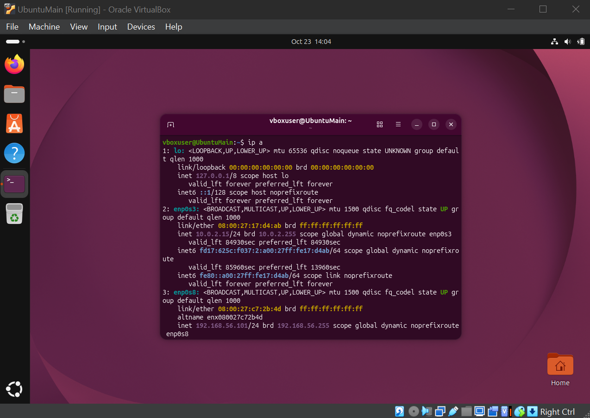
ip a for Main VM
```
ip a
```

---
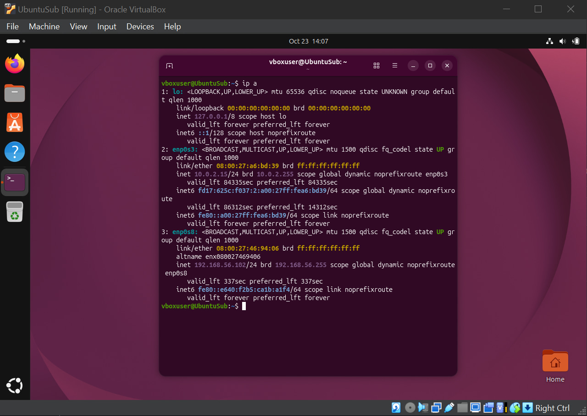
ip a for Sub VM
```
ip a
```

---
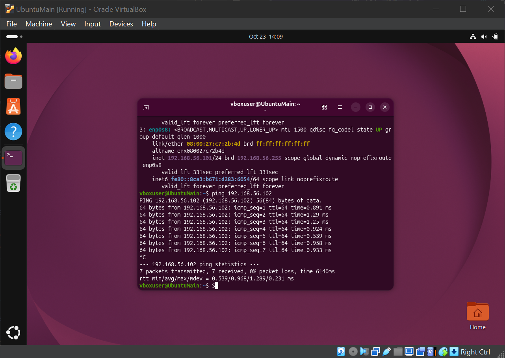
Successful ping
```
ping 192.168.56.102
```
## SSH setup
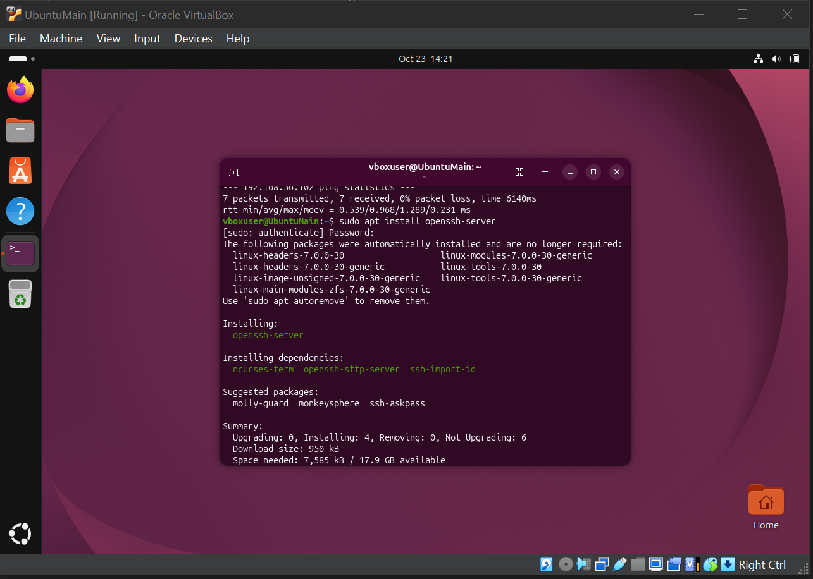
Installation for Main VM
```
sudo apt install openssh-server -y
sudo systemctl status ssh
```

---
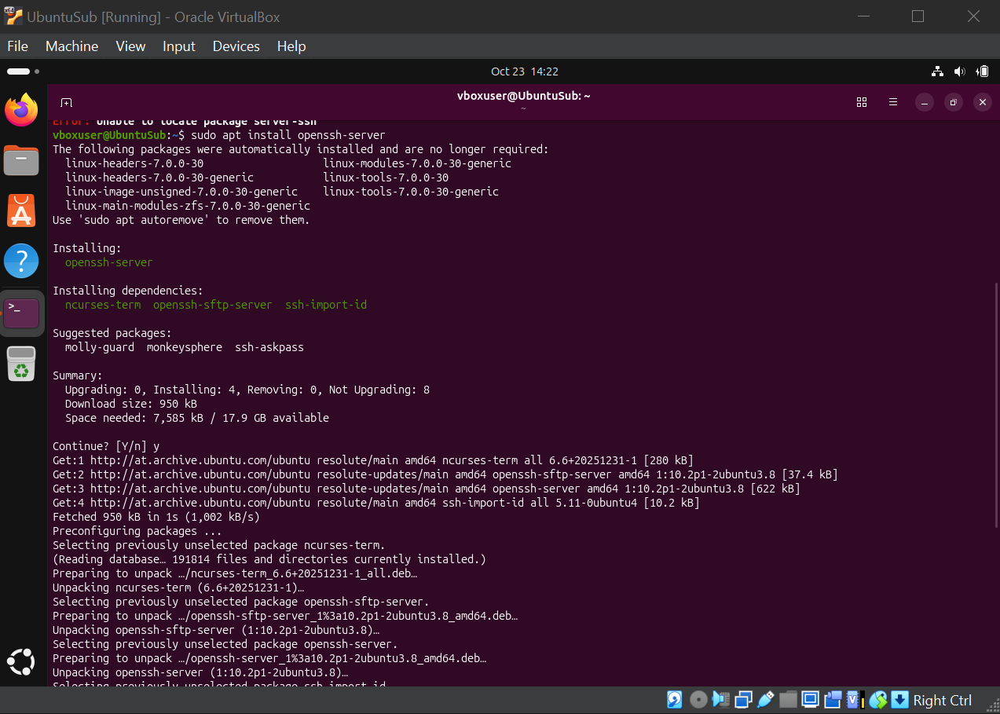
Installation for Sub VM
```
sudo apt install openssh-server -y
sudo systemctl status ssh
```

---
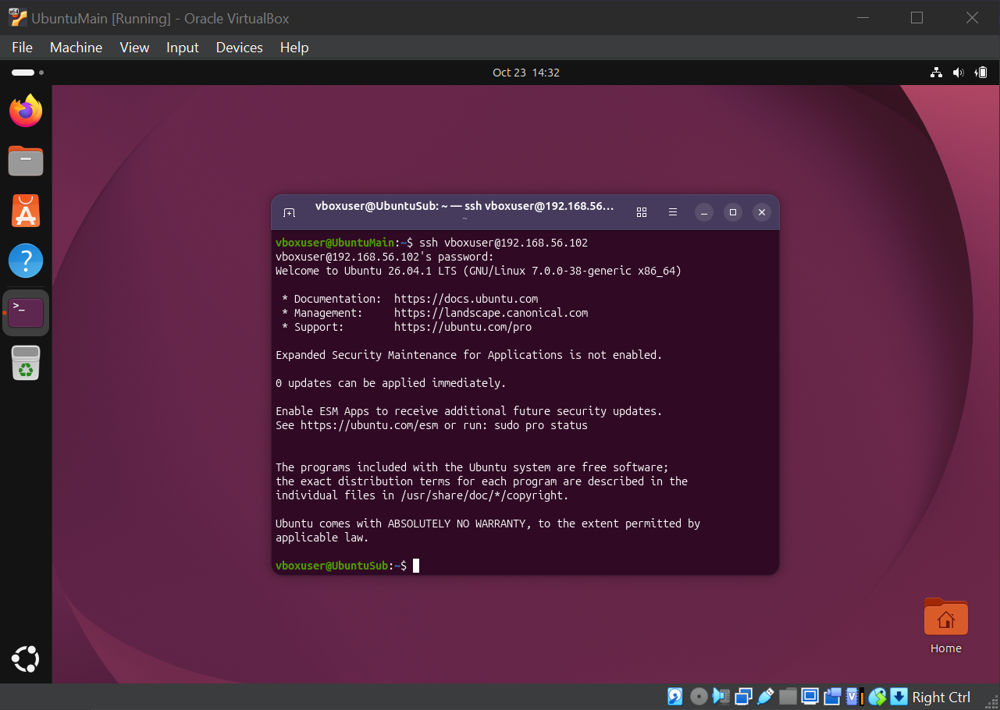
Connection established
```
ssh vboxuser@192.168.56.102
```
## Firewall (ufw) configuration
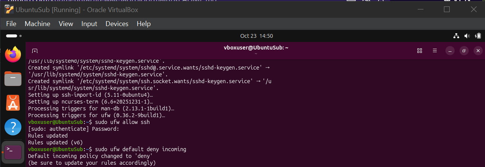
Now on Sub VM allowing SSH in ufw service, then denying all other - except what we allowed firstly.
```
sudo ufw allow ssh
sudo ufw default deny incoming
```

---
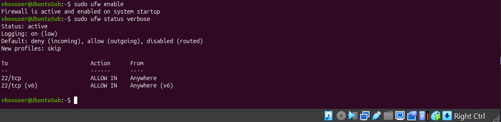
Enabling ufw and checking up actual config
```
sudo ufw enable
sudo ufw status verbose
```
## Testing

Starting a test web server on port 8000 on Sub VM and trying to check up connection using curl from Main VM 
```
python3 -m http.server 8000
```
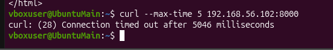
```
curl --max-time 5 192.168.56.102:8000
```

---
curl timed out after 5 seconds with no response, so the port is blocked by ufw. Enabling it on Sub VM as well and trying to reconnect 
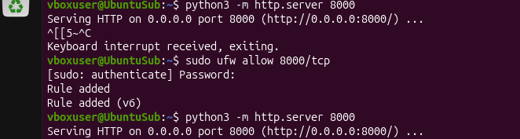
```
sudo ufw allow 8000/tcp
python3 -m http.server 8000
```
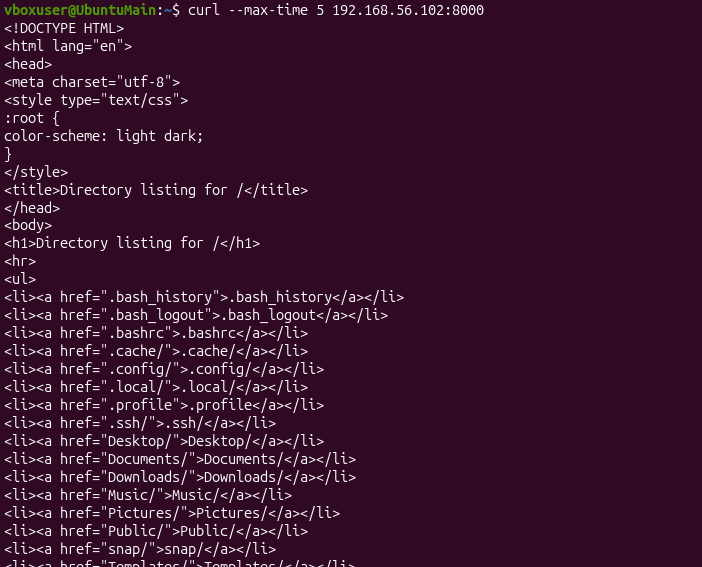
```
curl --max-time 5 192.168.56.102:8000
```
Connection established, curl returns HTTP output (directory listing page) - port is now reachable.

## Problems and conclusions
Problems:
- ssh: "Connection refused". Neither VM had an SSH server installed.
  - Fix: installed openssh-server on both machines.
- ssh: "Permission denied". I had used the hostname (UbuntuSub) instead of the username.
  - Fix: connected as vboxuser@192.168.56.102.

Conclusions:
- Allow SSH in ufw BEFORE enabling the firewall, otherwise remote access is lost.
- ufw filters new incoming connections; replies to outgoing connections still pass (stateful filtering).
